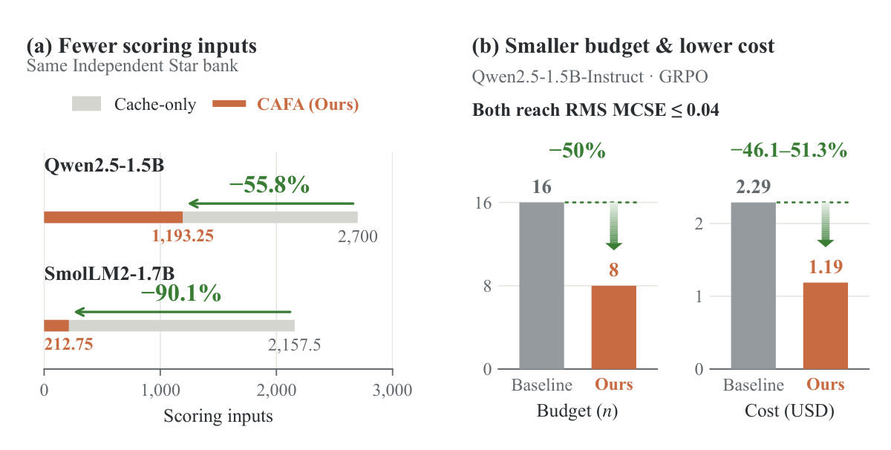

# Pay for the Difference: Exact Feedback Reduction for Language Model Comparison

**Status:** Under review at ICLR 2027.

**Version date:** October 18, 2026.

[Read the paper](submission.pdf)

## Overview

Figure 1 from the manuscript: fewer scoring inputs and lower comparison costs. See the paper for experimental settings and definitions.

## Abstract

Model iteration requires comparing checkpoints, but not every response score affects the comparisons of interest. Caching avoids rescoring identical responses, but still requires scores whose contributions cancel in the requested comparison. The challenge is to identify necessary scores before acquisition, accounting for the different requirements of means and covariances. Coupled generation increases response sharing while preserving each model’s output distribution; ContrastAware Feedback Acquisition (CAFA) then aggregates report coefficients to skip unnecessary scores and exactly recover the fully scored sample statistics. For a fixed sample bank and an otherwise unrestricted scorer, we characterize the necessary and sufficient queries for exact recovery of comparison means, either alone or jointly with ordinary sample covariances. On controlled updates, CAFA eliminates 55.8% and 90.1% of the scoring inputs remaining after caching for Qwen2.5-1.5B-Instruct and SmolLM2-1.7B-Instruct, respectively. Across three online group relative policy optimization (GRPO) trajectories, Independent Star + CAFA reaches an observed root mean square Monte Carlo standard error (RMS MCSE) of at most 0.04 at 46.1–51.3% lower recorded generation-plus-feedback cost than Independent autoregressive (AR) + Cache-only on the evaluated budget grid. All 504 report cells reproduce the fully scored statistics. We provide a modular implementation for existing response banks and external scorers, making exact feedback reduction a reusable step in language-model comparison.

## Materials

This repository contains the supplied manuscript and a figure extracted from it. Code and data are not included. The PDF is preserved as supplied, including its anonymous submission format.
